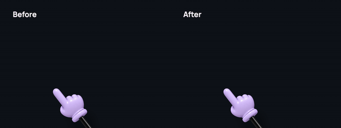
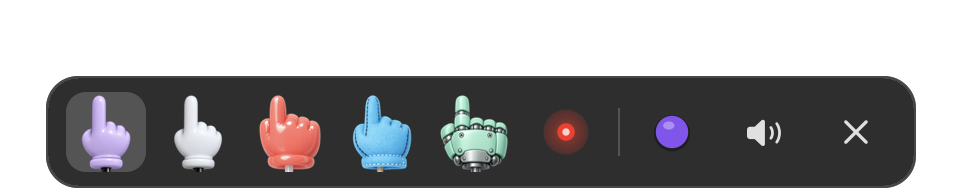
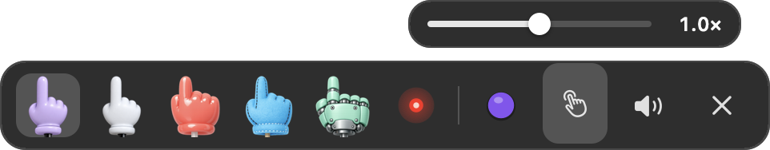

# TinyHand: expressive tap motion

A fork of [TinyHand](https://github.com/nilbuild/tinyhand) by Kamran Ahmed that changes the range of tap motion. For everything else (download, install, how to use it), see the [original repo](https://github.com/nilbuild/tinyhand).

In the original app, tapping only shrinks the hand a little. Here the stick swings up and down to make it more expressive, similar to how it would move in the physical world.

This repo is the source of a pull request to the original app. If it gets accepted, everyone using TinyHand would get the new tap motion with the app's regular updates.

[Try in your browser →](https://tumaranja.github.io/tinyhand/prototypes/tap-motion/)

## The motion

- **Swing up (0.13 s):** the fingertip lifts about 20% of the screen height (at swing range 1×) and a little to the right. The hand holding the stick rises about half as far with it, so the whole stick moves, not just the tip.
- **Swing down (0.09 s):** it swings down onto the spot and presses, then settles back. There's no wobble.
- **Sound:** the tap sound plays when the fingertip lands. The laser pointer is unchanged.
- **Drawing:** dragging skips straight to the pressed pose, so ink starts where you clicked.
- **Swing range:** a new button in the toolbar at the bottom of the screen opens a slider from 0.3× to 2×. It scales how far the stick swings; 1× is the default.

The code is `ArmView.swing(at:)` in [Sources/TinyHand/ArmView.swift](Sources/TinyHand/ArmView.swift). The browser prototype in [prototypes/tap-motion](prototypes/tap-motion) mirrors it.

## Toolbar

The toolbar at the bottom of the screen gets a new button, Swing range. It controls how much the stick swings on tap.

**Before**

**After**

## License

MIT, like the original. See [LICENSE](LICENSE). The original is © Kamran Ahmed; the swing tap changes are © tumaranja.
